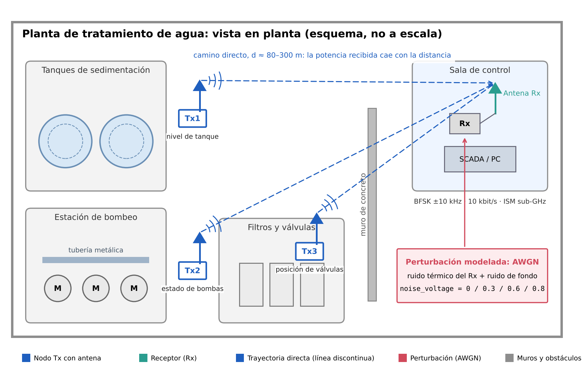
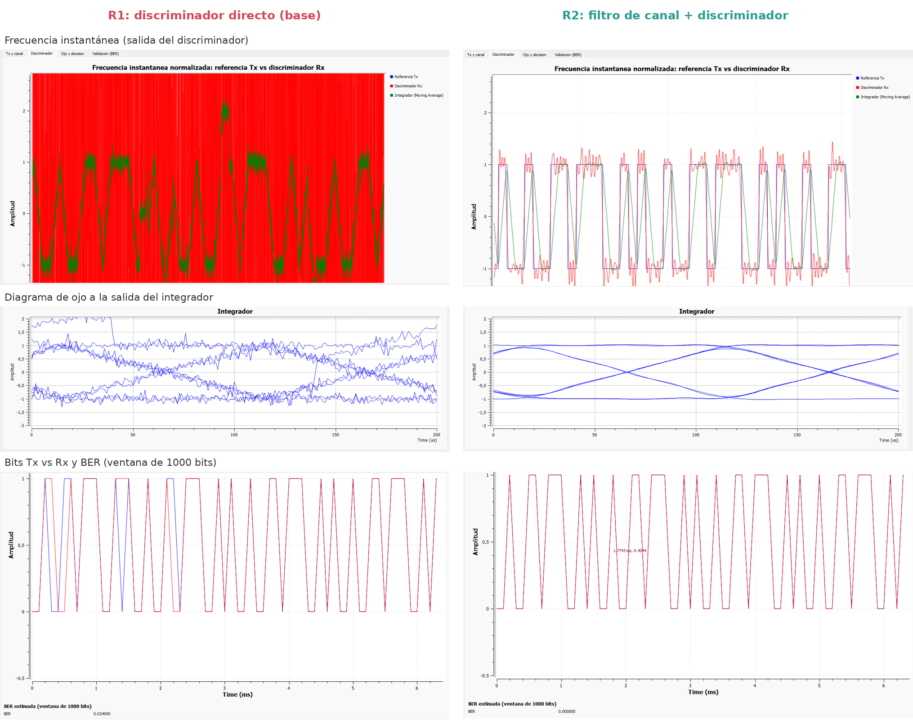

# Telemetría binaria BFSK en una planta de tratamiento de agua (Escenario S5)

**Blog del proyecto:** [https://Fervi23.github.io/ComunicacionesII_GrupoE1/blog/](https://Fervi23.github.io/ComunicacionesII_GrupoE1/blog/)

**Video de socialización:** _enlace por agregar_

Comunicaciones II (27145), Proyecto Integrador 2026, Universidad Industrial de Santander.

**Grupo E1. Integrantes:**

| Nombre | Código |
| --- | --- |
| Jorge Mario Sánchez Arévalo | 2234630 |
| Sebastián Díaz Zuleta | 2224034 |
| Ferney Esteban Vinasco Flórez | 2202935 |



## Resumen

Diseñamos y simulamos en GNU Radio un enlace de telemetría para una planta de tratamiento de agua: nodos en tanques, bombas y válvulas envían estados a la sala de control mediante BFSK de fase continua. El canal se modela como AWGN (atenuación por distancia y ruido térmico del receptor). Implementamos un receptor no coherente: filtro de selección de canal, discriminador de frecuencia, integrador por símbolo, muestreo de una muestra por símbolo y decisión con umbral 0. Comparamos este receptor (R2) con el discriminador directo de la base (R1) en cuatro niveles de ruido. R1 entra en la región de umbral del discriminador y llega a BER = 0.13 en la prueba fuerte; R2 no comete errores en ninguna prueba. El filtro de canal desplaza la curva de BER unos 13 dB.

## Parámetros del sistema

| Parámetro | Valor | Relación |
| --- | --- | --- |
| Modulación | BFSK (CPFSK), M = 2 | k = log2 M = 1 |
| Rs | 10 000 baudios | samp_rate / sps |
| Rb | 10 000 bit/s | Rs · k |
| SPS | 100 | |
| fs (samp_rate) | 1 MS/s | Rs · SPS |
| Δf (fsk_deviation) | 10 kHz | h = 2Δf / Rs = 2 |
| Ancho de banda | ≈ 40 kHz | Carson: 2(Δf + Rs) |
| Perturbación | AWGN, `noise_voltage` | Channel Model |

## Archivo GRC principal y cómo ejecutarlo

- Archivo: [`grc/archivos_modificados/S5_BFSK_TxCanalRx_GrupoE1.grc`](grc/archivos_modificados/S5_BFSK_TxCanalRx_GrupoE1.grc) (GNU Radio 3.10).
- Abrir con `gnuradio-companion` y ejecutar (F6). La ventana tiene cuatro pestañas: *Tx y canal*, *Discriminador*, *Ojo y decisión* y *Validación (BER)*.
- Controles: `noise_voltage` (pruebas A–D), `fsk_deviation` y el selector **Receptor** (R1 o R2).
- La variable `ajuste_muestreo` (por defecto 0) corrige la fase de muestreo si el diagrama de ojo muestra el instante óptimo desplazado. Se fija en la Prueba A, hasta obtener BER = 0.
- Si se cambia `fsk_deviation`, recalcular `lpf_cutoff = fsk_deviation + symbol_rate`.

### Modificaciones respecto a la base (`Guia2_BASE_FSK_Canal_Discriminador.grc`)

| Cambio | Bloque o variable | Motivo |
| --- | --- | --- |
| Δf de 20 a 10 kHz | `fsk_deviation` | h = 2: tonos ortogonales y 40 kHz de ancho de banda |
| Rango de ruido hasta 5 | `noise_voltage` | Prueba de estrés del receptor R2 |
| Filtro de selección de canal | `filtro_canal` (FIR, `lpf_taps`) | Evitar el efecto umbral del discriminador |
| Delay en R1 + mezcla ponderada | `compensa_r1`, `peso_r1`, `peso_r2`, `selector_receptor` (Add), `receptor` | Comparar R1 y R2 con la misma latencia; ambos caminos corren siempre, así que cambiar de receptor no desalinea los flujos |
| Integrador por símbolo | `integrador_simbolo` (Moving Average) | Filtro acoplado al pulso rectangular |
| Muestreo | `fase_muestreo` (Skip Head), `una_por_simbolo` (Keep One in N) | Una muestra por símbolo en el máximo del ojo |
| Decisión | `decision_binaria` (Binary Slicer) | Umbral 0 |
| Validación | `retardo_ref_bits`, `comparador_xor`, `ber_ventana`, `ber_estimada` | BER en ventanas de 1000 bits |
| Observación | `diagrama_ojo`, `frecuencia_instantanea`, `psd_tx_canal_rx`, `bits_tx_vs_rx` | Evidencias de la guía |

## Pruebas

| Prueba | Severidad | noise_voltage | Eb/N0 | BER R1 | BER R2 |
| --- | --- | --- | --- | --- | --- |
| A | Referencia | 0 | ∞ | 0 | 0 |
| B | Suave | 0.3 | 30.5 dB | 0 | 0 |
| C | Media | 0.6 | 24.4 dB | 2.4 × 10⁻² | 0 |
| D | Fuerte | 0.8 | 21.9 dB | 1.3 × 10⁻¹ | 0 |

**Verificación en GNU Radio 3.10.12** (Windows, radioconda, 7 de noviembre de 2026). BER leída en el Number Sink del GRC, ventana de 1000 bits:

| Prueba | BER R1 (GRC) | BER R2 (GRC) |
| --- | --- | --- |
| A | 0 | 0 |
| B | 0 | 0 |
| C | 0.022 – 0.033 | 0 |
| D | 0.155 – 0.169 | 0 |



Las capturas completas de las cuatro pruebas están en [`figures/pantallazos_GNU_radio/`](figures/pantallazos_GNU_radio/) y las seleccionadas en [`figures/gnuradio/`](figures/gnuradio/). Los resultados coinciden con el modelo; en la prueba D, R1 da una BER algo mayor en GNU Radio (≈ 0.16 frente a 0.13).

Datos completos en [`data/tablas_de_pruebas/`](data/tablas_de_pruebas/). Las BER se calcularon con el modelo numérico de [`simulacion_referencia/`](simulacion_referencia/), que reproduce la cadena del GRC con 10⁵ bits por prueba.

## Conclusión principal

El factor decisivo del receptor BFSK no es el decisor sino el ancho de banda de ruido que ve el discriminador. Un filtro de selección de canal antes de la detección evita el efecto umbral y mantiene el enlace sin errores en las cuatro pruebas.

## Estructura del repositorio

```
ComunicacionesII_GrupoE1/
├── README.md
├── grc/
│   ├── archivos_originales_o_referencia/   (archivos .grc entregados por el curso)
│   └── archivos_modificados/               S5_BFSK_TxCanalRx_GrupoE1.grc
├── figures/
│   ├── escenario/                           imagen contextual
│   ├── psd/                                 PSD de referencia, bajo ruido y vs Δf
│   ├── constelacion_o_fsk/                  frecuencia instantánea, ojos, bits, BER
│   ├── gnuradio/                            capturas seleccionadas de GNU Radio
│   ├── pantallazos_GNU_radio/               capturas completas A–D, R1 y R2
│   └── diagramas_tecnicos/                  diagrama Tx–canal–Rx, estados FSK
├── data/tablas_de_pruebas/                  pruebas.csv, barridos
├── docs/
│   ├── informe_final.pdf                    informe IEEE
│   ├── ficha_decision_tecnica.pdf
│   ├── bitacora.md
│   └── guion_video.md
├── simulacion_referencia/                   modelo Python y scripts de figuras
├── blog/                                    blog del proyecto (GitHub Pages)
└── referencias/fuentes_y_enlaces.md
```

Para regenerar datos y figuras: `python3 simulacion_referencia/pruebas.py`, luego `figs.py` y `figs_esquemas.py` (requiere NumPy, SciPy y Matplotlib).

_Última actualización: 6 de noviembre de 2026._
